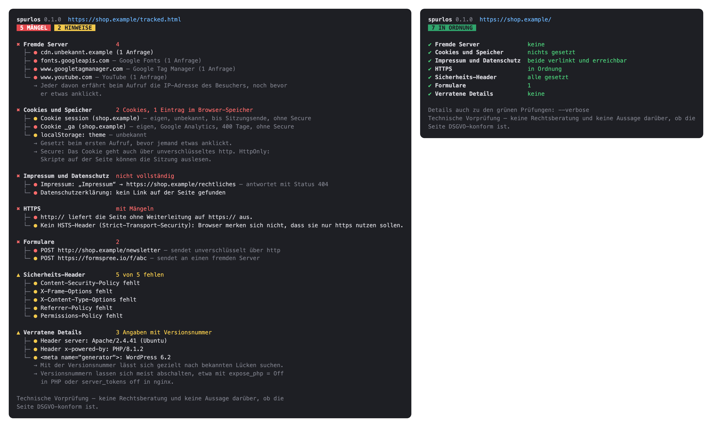

# spurlos

Ruft eine Website so auf wie ein neuer Besucher, der noch nichts angeklickt hat, und zeigt dir:

- **welche fremden Server** dabei angefragt werden, etwa Google Fonts, Tag Manager, YouTube oder ein CDN. Jeder davon erfährt die IP-Adresse des Besuchers.
- **welche Cookies und Einträge im Browser-Speicher** schon vor jeder Einwilligung gesetzt sind, und ob darunter bekannte Tracker oder Cookies fremder Domains sind.
- ob **Impressum und Datenschutzerklärung** verlinkt sind und sich öffnen lassen.
- ob **HTTPS** sauber eingerichtet ist: Zertifikat, Weiterleitung von http, HSTS.
- welche **Sicherheits-Header** fehlen.
- wohin **Formulare** senden: verschlüsselt an die eigene Seite, an einen fremden Server oder unverschlüsselt.
- ob Header oder Seite **die Software dahinter samt Version** verraten, etwa `X-Powered-By: PHP/8.1.2` oder `WordPress 6.2`.

```
npx spurlos beispiel-firma.de
```

Links eine Seite mit Mängeln, rechts eine saubere:



Die vollständigen Berichte beider Seiten, als Text auf Deutsch und Englisch und als JSON, liegen in [`examples/`](examples/). Beide Seiten stammen aus den Tests und laufen offline unter `https://shop.example`; `npm run examples` erzeugt alles neu.

spurlos nutzt einen echten Browser (Chromium über Playwright). Es findet also auch Anfragen und Cookies, die erst per JavaScript entstehen. Impressum, Datenschutzerklärung und die http-Adresse ruft es getrennt davon auf; diese Aufrufe zählen nicht zu den Anfragen und Cookies der Seite. Ob http auf https weiterleitet, fragt es direkt beim Server und nicht über den Browser nach, denn Chromium wechselt von sich aus auf https.

## Installation

Mit Docker, ohne Node:

```
docker run --rm ghcr.io/mmohrx/spurlos beispiel-firma.de
```

Oder mit Node.js 22 oder neuer. Beim ersten Mal braucht Playwright seinen Browser:

```
npx playwright install chromium-headless-shell
npx spurlos <url>
```

| Option | |
|---|---|
| `--lang de\|en` | Sprache des Berichts, Standard `de` |
| `--verbose`, `-v` | Details auch zu den grünen Prüfungen |
| `--json` | vollständiges Ergebnis als JSON |
| `--user-agent <kennung>` | eigene Browserkennung für alle Aufrufe |

Oben steht die Bilanz, darunter die Prüfungen mit den roten zuerst. Rote und gelbe Prüfungen zeigen jeden Befund, grüne nur eine Zeile. Im Terminal ist der Bericht farbig. Leitest du die Ausgabe in eine Datei oder eine Pipe um oder setzt `NO_COLOR`, bleibt es reiner Text.

## Ampel

| Prüfung | 🟢 | 🟡 | 🔴 |
|---|---|---|---|
| Fremde Server | keine | – | mindestens eine Anfrage an eine andere Domain |
| Cookies und Speicher | nichts gesetzt, oder nur bekannte Sitzungs- und Sicherheits-Cookies | eigene Cookies oder Einträge, die spurlos nicht kennt; ein Cookie ohne `Secure` auf einer https-Seite; ein Sitzungs-Cookie ohne `HttpOnly` | Cookie einer fremden Domain oder eines bekannten Trackers |
| Impressum und Datenschutz | beide verlinkt und erreichbar | – | ein Link fehlt oder die Seite antwortet mit einem Fehler |
| HTTPS | https, http leitet weiter, HSTS, Zertifikat noch 14 Tage oder länger gültig | kein HSTS, über http antwortet nichts, Zertifikat weniger als 14 Tage gültig | kein https, http ohne Weiterleitung, Zertifikat weniger als 7 Tage gültig oder abgelaufen |
| Sicherheits-Header | alle gesetzt | einer oder mehrere fehlen | – |
| Formulare | keine oder alle senden verschlüsselt an die eigene Seite | eines sendet an einen fremden Server | eines sendet unverschlüsselt über http |
| Verratene Details | nichts, oder nur der Name der Software | eine Versionsnummer in `Server`, `X-Powered-By`, `X-AspNet-Version`, `X-Generator` oder `<meta name="generator">` | – |

Geprüft werden bei den Headern `Content-Security-Policy`, `X-Frame-Options` (oder `frame-ancestors` in der CSP), `X-Content-Type-Options: nosniff`, `Referrer-Policy` und `Permissions-Policy`. CSP und Referrer-Policy zählen auch als `<meta>`-Tag, für Hoster wie GitHub Pages, bei denen sich keine Header setzen lassen. Impressum und Datenschutzerklärung erkennt spurlos am Linktext oder an der Adresse, auf Deutsch und Englisch. Ein Link wie „Impressum & Datenschutz“ zählt für beides.

Jeder einzelne Befund hat im Bericht seine eigene Ampel, die Prüfung bekommt die schlechteste davon. So sieht man, welcher Eintrag eine Prüfung gelb oder rot macht.

Bekannte Sitzungs- und Sicherheits-Cookies sind zum Beispiel `XSRF-TOKEN` und `<app>-session` von Laravel, `PHPSESSID`, `JSESSIONID`, `csrftoken` von Django und `__cf_bm` von Cloudflare. Im Browser-Speicher kennt spurlos Einträge, die Frameworks selbst anlegen, etwa die Scroll-Positionen von Vue Router (`vue-router:scroll`). Die Liste steht in `src/services.json` (Kategorie `necessary`).

Subdomains zählen zur eigenen Seite (`cdn.firma.de` gehört zu `www.firma.de`), dabei gilt die Public Suffix List (`firma.co.uk`).

## Wie spurlos aufruft

Die Seite selbst öffnet spurlos als normaler Chrome und hängt seinen Namen an die Kennung an:

```
Mozilla/5.0 (X11; Linux x86_64) AppleWebKit/537.36 (KHTML, like Gecko) Chrome/159.0.0.0 Safari/537.36 spurlos/0.1.0
```

„HeadlessChrome“ fehlt darin mit Absicht, auch in den Client Hints (`sec-ch-ua`). Viele Cookie-Banner und Tracker laden für Aufrufe, die sie für Bots halten, gar nicht erst. spurlos würde dann eine saubere Seite melden, während echte Besucher getrackt werden. Verstecken will sich spurlos trotzdem nicht: Der eigene Name steht in jeder Kennung, und `navigator.webdriver` bleibt `true`.

Impressum, Datenschutzerklärung und die Weiterleitung von http fragt spurlos offen als Bot ab, denn dabei ändert eine Bot-Erkennung nichts:

```
spurlos/0.1.0 (+https://github.com/mmohrx/spurlos)
```

## In der CI

```
npx spurlos https://staging.firma.de || echo "neue Spuren"
```

Exit-Code `0` ohne roten Befund, `1` mit rotem Befund, `2`, wenn die Seite sich nicht prüfen ließ. Mit `--json` kommt das vollständige Ergebnis samt aller Anfragen als JSON.

## Bekannte Dienste ergänzen

Welche Hosts und Cookies zu welchem Dienst gehören, steht in [`src/services.json`](src/services.json). Hosts gelten samt Subdomains, Cookie-Namen als Anfang (`_ga` deckt auch `_ga_ABC123` ab), mit `*` vorn als Ende (`*-session`). Fehlt ein Dienst, freue ich mich über einen Pull Request.

## Was spurlos nicht tut

- Es sucht nicht aktiv nach Lücken. Ausgewertet wird nur, was ein normaler Aufruf der Seite ohnehin liefert; Adressen wie `/.env`, `/.git/` oder `/phpinfo.php` fragt spurlos nicht ab. So lässt es sich gegen jede Seite laufen, ohne sie abzuklopfen.

- Es klickt keinen Cookie-Banner an. Geprüft wird der Zustand vor jeder Entscheidung des Besuchers.
- Es liest Impressum und Datenschutzerklärung nicht, sondern prüft nur, ob sie verlinkt und erreichbar sind.
- Es gibt keine Rechtsberatung. Ein grüner Bericht heißt nicht, dass eine Seite DSGVO-konform ist, und ein roter nicht, dass sie es nicht ist.

## Entwickeln

```
pnpm install
pnpm exec playwright install chromium-headless-shell
pnpm test        # Unit-Tests und Browser-Tests gegen test/sites, ohne Netz
pnpm typecheck
pnpm build       # nach dist/
node src/cli.ts <url>
```

## Lizenz

MIT, © 2026 Martin Mohr
